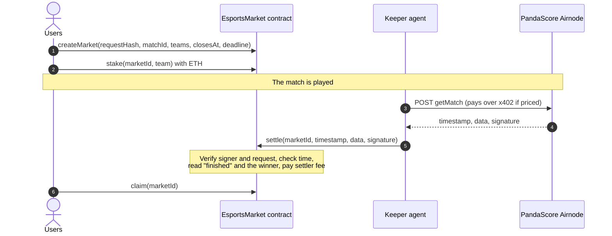
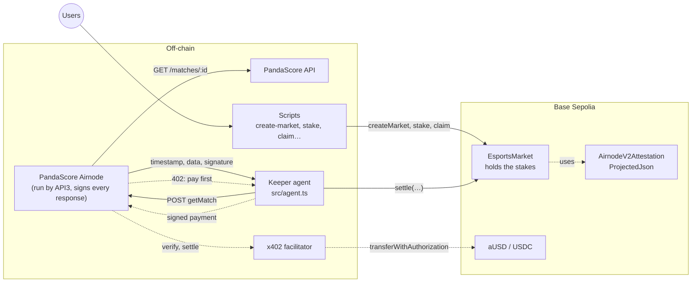
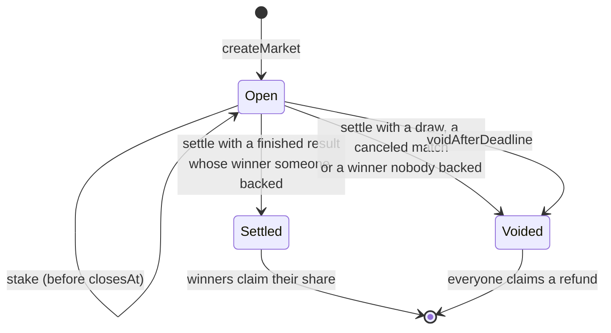
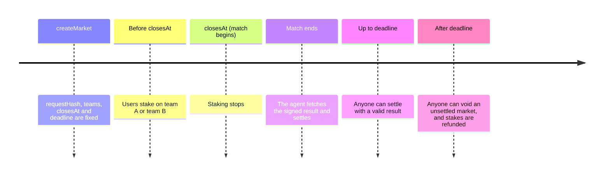
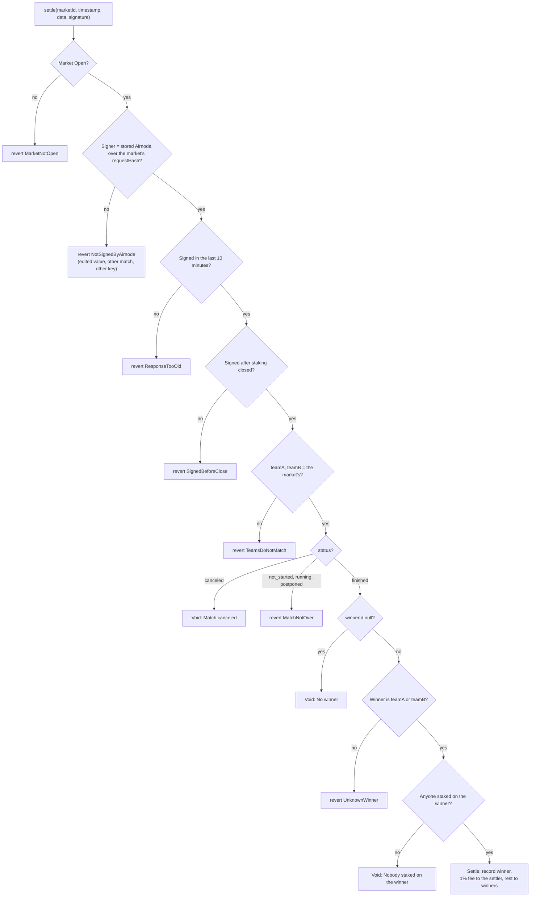
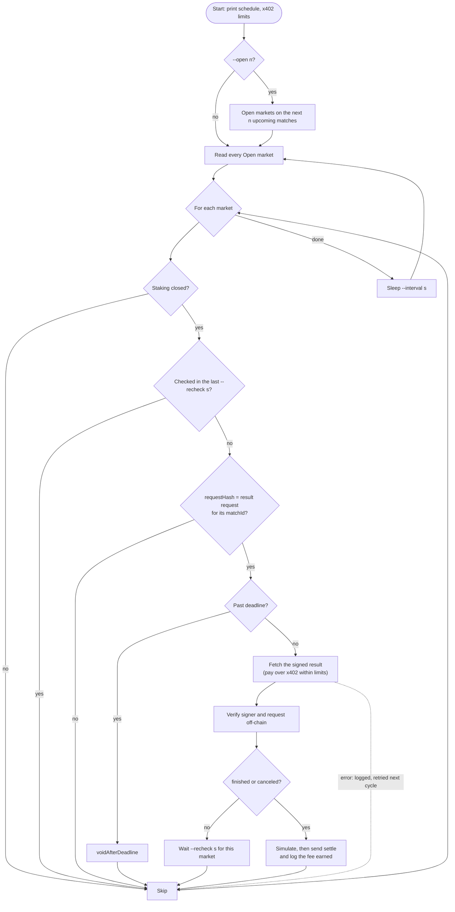
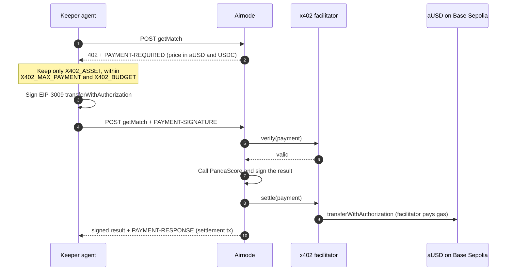

# Esports market: a prediction market that settles itself

An esports prediction market built on [AirnodeHub](https://airnodehub.api3.org). People stake ETH on one of two teams,
and anyone settles the market with a match result that the
[PandaScore](https://airnodehub.api3.org/explore/pandascore) Airnode signed. The contract checks the signature, the
request and the time itself, so it never has to trust whoever brings the result. A keeper agent does that job for a 1%
settler fee, and pays for the data over x402 when the operation is priced.

It is a worked example for the [AirnodeHub hackathon](https://api3dao.github.io/airnodehub-hackathon/), built on the
hackathon's starter template.

**Who relies on the data, and what goes wrong if it is faked:** every staker relies on the match result. A faked result
would pay the whole pot to the losing side.

## Contents

- [What it shows](#what-it-shows)
- [How it works](#how-it-works)
- [Design](#design)
- [Live on Base Sepolia](#live-on-base-sepolia)
- [Prerequisites](#prerequisites)
- [Installation](#installation)
- [Configuration](#configuration)
- [Run the demo](#run-the-demo)
- [Command reference](#command-reference)
- [The keeper agent](#the-keeper-agent)
- [The tamper test](#the-tamper-test)
- [Contract reference](#contract-reference)
- [Tests](#tests)
- [Deploy to Base Sepolia](#deploy-to-base-sepolia)
- [Use another API](#use-another-api)
- [Security and limitations](#security-and-limitations)
- [Troubleshooting](#troubleshooting)
- [Hackathon submission checklist](#hackathon-submission-checklist)
- [Project layout](#project-layout)
- [Credits and license](#credits-and-license)

## What it shows

| Hackathon requirement                                              | Where it is                                                                                                               |
| ------------------------------------------------------------------ | ------------------------------------------------------------------------------------------------------------------------- |
| A contract that verifies an Airnode signature in its core workflow | [`EsportsMarket.settle`](contracts/EsportsMarket.sol): no signed result, no payout                                        |
| Signer, request and time checks                                    | [The three checks](#the-three-checks)                                                                                     |
| A way for judges to submit valid and invalid responses             | `pnpm tamper-test <market id>`, and the 18 contract tests                                                                 |
| Removing the integration breaks the use case                       | Without a signed result a market can only time out and refund                                                             |
| Agent bonus: repeated autonomous cycles, x402, limits, failures    | [`pnpm agent`](#schedule-spending-limits-and-failure-handling) runs on a schedule, pays within limits, settles on its own |

## How it works



1. **Open a market.** Someone picks a PandaScore match and opens a market with the hash of its result request, its two
   team ids, the time staking closes (when the match begins) and a refund deadline.
2. **Take positions.** Users stake ETH on team A or team B before staking closes.
3. **Fetch the result.** After the match, anyone, usually the keeper agent, asks the PandaScore Airnode for the result.
4. **Signed result.** The Airnode calls PandaScore, cuts the response down to four fields and signs them.
5. **Settle.** The agent sends the timestamp, data and signature to the contract.
6. **Verify, then act.** The contract checks the signature, the request and the time, reads the winner, and pays the
   settler fee.
7. **Claim.** Winners claim their share of the pot.

### The request

Each market stores the hash of one request: the `getMatch` operation for its match, projected to the four fields that
settle it ([`src/pandascore.ts`](src/pandascore.ts)).

```json
{
  "operation": "getMatch",
  "parameters": { "match_id_or_slug": "1200600" },
  "responseProjection": {
    "status": "/status",
    "winnerId": "/winner_id",
    "teamA": "/opponents/0/opponent/id",
    "teamB": "/opponents/1/opponent/id"
  }
}
```

The hash depends only on the request, so it is known before the match is played:
`requestHash = keccak256(JSON.stringify(["getMatch", sortedParameters, sortedProjection]))`. `pnpm create-market`
derives it for you.

### The signed result

A real one, from [`test/fixtures/match-1200600.json`](test/fixtures/match-1200600.json):

```json
{
  "airnode": "0xd9D29FEDc3737aD5198611457fE04aB08a739C7b",
  "requestHash": "0xec1bafc62fe915a1c9b2c52b5f0e09089f1d62be64f14a697e8e3ba2d21aefbb",
  "timestamp": "1792528349",
  "data": "{\"status\":\"finished\",\"winnerId\":135505,\"teamA\":135743,\"teamB\":135505}",
  "signature": "0x7dce9026…"
}
```

The Airnode signs `keccak256(abi.encodePacked(requestHash, timestamp, data))` with EIP-191, so the contract can check it
with `ecrecover`. Change one byte of any of the three and the recovered address changes.

### The three checks

`settle` makes the three checks from the hackathon brief before it acts:

| Check   | How                                                                                                           | Stops                   |
| ------- | ------------------------------------------------------------------------------------------------------------- | ----------------------- |
| Signer  | `AirnodeV2Attestation.verify` recovers the signer and compares it with the Airnode address stored at deploy   | wrong key, edited value |
| Request | The market's stored request hash goes into the digest, so a result for another match recovers another address | another match           |
| Time    | Signed no more than 10 minutes ago (`MAX_RESPONSE_AGE`), and after staking closed                             | stale result            |

Then it reads the fields by name with `ProjectedJson`, checks that the teams match the market, and acts on the status:

| Signed result                                | Outcome                                                        |
| -------------------------------------------- | -------------------------------------------------------------- |
| `finished` with a winner that someone backed | **Settled.** 1% to the settler, the rest to the winners        |
| `finished` with `winnerId` null (a draw)     | **Voided.** Everyone takes their stake back                    |
| `finished` with a winner that nobody backed  | **Voided**                                                     |
| `canceled`                                   | **Voided**                                                     |
| `not_started`, `running`, `postponed`        | Reverts with `MatchNotOver`. Try again later                   |
| No valid result before the deadline          | Anyone can call `voidAfterDeadline`, then everyone is refunded |

## Design

### System overview

Five parts, and only the contract holds money. Everything off-chain is untrusted: the contract accepts a result only if
the PandaScore Airnode signed it.



| Part                         | Trusted with                       | Can it cheat?                                                                    |
| ---------------------------- | ---------------------------------- | -------------------------------------------------------------------------------- |
| `EsportsMarket`              | The stakes                         | No. It is code on-chain, and it pays only on a valid signed result               |
| PandaScore Airnode           | Reporting what PandaScore returned | Only by signing a false result, which is the trust assumption of any data source |
| Keeper agent, scripts, users | Nothing                            | No. Anything they submit must carry the Airnode's signature                      |
| x402 facilitator             | Moving the agent's payment         | It can only execute the exact transfer that the agent signed                     |

### A market's lifecycle



Timeline of one market:



### What settle checks

`settle` runs every check before it changes anything. Each failed check reverts with a custom error, so a bad result
leaves the market untouched.



### The agent's cycle



### An x402 payment

What happens when an Airnode prices `getMatch`. `pnpm x402-check` runs the same handshake against a real facilitator.



### Design decisions

| Decision                                                      | Why                                                                                                                                            |
| ------------------------------------------------------------- | ---------------------------------------------------------------------------------------------------------------------------------------------- |
| One stored request hash per market                            | The signature covers the hash, so a real result for any other match fails. The hash is known before the match, so it can be stored at creation |
| Project the response to four fields                           | The contract parses a small, fixed object, and the projection is part of the signed request, so the fields cannot be swapped                   |
| Store the team ids and check them at settlement               | Ties the stakes to the teams in the signed result, so a creator cannot label the teams wrongly                                                 |
| Require the result to be signed after staking closed          | A result signed before the match cannot settle it                                                                                              |
| 10-minute freshness window                                    | Meets the tamper test's "too old" case. A match result does not change, so a short window costs nothing                                        |
| Void instead of guessing                                      | A draw, a cancellation or a winner nobody backed refunds everyone rather than locking or misdirecting funds                                    |
| Refund deadline                                               | A contract cannot fetch data. If nobody brings a result, stakers still get their money back                                                    |
| 1% settler fee, paid to whoever settles                       | Gives an untrusted agent a reason to deliver the result. The contract does not care who it is                                                  |
| Anyone can settle; the agent verifies off-chain first         | Settling needs no permission. Off-chain verification and simulation keep a bad result from costing gas                                         |
| Pull payments with `claim`                                    | Each staker withdraws their own share, and settlement stays a fixed cost however many people staked                                            |
| Native ETH stakes                                             | Keeps the demo to one token. An ERC-20 version changes `stake` and the transfers only                                                          |
| Official `@x402/fetch` client with a per-call and per-run cap | Same client as the API3 starter and docs, plus the spending limits the agent bonus asks for                                                    |

## Live on Base Sepolia

`EsportsMarket` is deployed on Base Sepolia at
[`0xa15Ff49ee654454783E4A3FF18EAD49ff99B175e`](https://sepolia.basescan.org/address/0xa15Ff49ee654454783E4A3FF18EAD49ff99B175e).
Every transaction from the test run on 2026-10-25, in order. All 11 succeeded.

| #   | Step                                                                 | From                      | Gas       | Transaction                                                                                                                 |
| --- | -------------------------------------------------------------------- | ------------------------- | --------- | --------------------------------------------------------------------------------------------------------------------------- |
| 1   | Fund Alice with 0.02 ETH                                             | Deployer `0xcbC9…A448`    | 21,000    | [`0xa7721d34…c5d116`](https://sepolia.basescan.org/tx/0xa7721d340ac2f135ac8c0c4294c6e258826e8e1bf099867ae971ff6c1ac5d116)   |
| 2   | Fund Bob with 0.02 ETH                                               | Deployer                  | 21,000    | [`0x9e9262c1…9035e5`](https://sepolia.basescan.org/tx/0x9e9262c118484febf32f47e7ae0cdbf05d6132fb82287011eef0c8d6629035e5)   |
| 3   | Fund the agent with 0.01 ETH                                         | Deployer                  | 21,000    | [`0x98cb1ba2…934578`](https://sepolia.basescan.org/tx/0x98cb1ba20b5d549acfa2ee5283898e8f88cda6fbb03e246080ff7cae09934578)   |
| 4   | Deploy `EsportsMarket`                                               | Deployer                  | 2,345,141 | [`0xc44cb3d5…bd080a`](https://sepolia.basescan.org/tx/0xc44cb3d5a01fdf7d0ac6aafba4435589e9f97c8267258b9a49de6ef079bd080a)   |
| 5   | Mint 5 aUSD from the faucet (`pnpm payer --mint 5`)                  | Agent `0x4968…9B35`       | 85,068    | [`0xbee21a80…6e93de`](https://sepolia.basescan.org/tx/0xbee21a80ad2abc72f3cdadd97ca0960fff32e9acbe0d0c68379f098bbe6e93de)   |
| 6   | Open market 1 on match 1200600, BST.A vs RED.A                       | Deployer                  | 116,626   | [`0x4fb1a779…271fd90`](https://sepolia.basescan.org/tx/0x4fb1a77980ce0e8ff9ed0ad0c3ac388ba1fd4e8ba50c748de2e534b84271fd90)  |
| 7   | Alice stakes 0.004 ETH on BESTIA Academy                             | Alice `0x2167…ED89`       | 73,022    | [`0x93793038…9afbd0`](https://sepolia.basescan.org/tx/0x9379303891cb3c2b1fe3a1e978913f1057dd3250e5e5d655410f3a009b9afbd0)   |
| 8   | Bob stakes 0.002 ETH on RED Canids Academy                           | Bob `0xbd7E…C764`         | 73,198    | [`0x100a6dd9…39a3cb`](https://sepolia.basescan.org/tx/0x100a6dd97dd9cbb60d2f1daaca5140dbbbac02a4b4756ff48f28fd40cd39a3cb)   |
| 9   | The agent settles with the signed result: RED.A won, fee 0.00006 ETH | Agent                     | 174,471   | [`0xe4410765…faf4f47b`](https://sepolia.basescan.org/tx/0xe4410765e1dc88fb4dc44d246769f8bfd248f4013c15060e7f293e8dfaf4f47b) |
| 10  | Bob claims 0.00594 ETH                                               | Bob                       | 64,262    | [`0x7b17f416…87dcf6`](https://sepolia.basescan.org/tx/0x7b17f416946eaef0cc4372dc6183f9634efe8db305fe6764ac3fcabac587dcf6)   |
| 11  | The agent pays 0.01 aUSD over x402 (`pnpm x402-check`)               | Facilitator `0xd407…f1bf` | 98,458    | [`0x0c49fea2…ec68463`](https://sepolia.basescan.org/tx/0x0c49fea208f957736cc12a6a2025fbe17b2b06efee127d2a2a3747ac7ec68463)  |

- Steps 6 to 10 are one run of `pnpm demo --stake 0.002`. Between steps 8 and 9, the tamper test passed all five cases as
  `eth_call`s, which leave no transaction.
- In step 11 the sender is the x402.org facilitator, not the agent: the facilitator submitted the agent's signed
  authorization and paid the gas, and 0.01 aUSD moved from the agent to the deployer.
- Alice backed the loser, so she had nothing to claim. The pot was 0.006 ETH: 0.00006 ETH to the agent, 0.00594 ETH to
  Bob, who held all the winning stake.

| Account            | Address                                                                                                                         | Role                                                            |
| ------------------ | ------------------------------------------------------------------------------------------------------------------------------- | --------------------------------------------------------------- |
| Deployer           | [`0xcbC97747Dc24DC3A2565f479644155a8d181A448`](https://sepolia.basescan.org/address/0xcbC97747Dc24DC3A2565f479644155a8d181A448) | Deployed the market, opened market 1, received the x402 payment |
| Alice              | [`0x21675bB470fcD8C12400E88F0Bd9520d5428ED89`](https://sepolia.basescan.org/address/0x21675bB470fcD8C12400E88F0Bd9520d5428ED89) | Staker                                                          |
| Bob                | [`0xbd7E39101CCD5a83b2FD2954a8E14A16947Dc764`](https://sepolia.basescan.org/address/0xbd7E39101CCD5a83b2FD2954a8E14A16947Dc764) | Staker                                                          |
| Keeper agent       | [`0x49685eF8ed97f3E428e82c0Df67Cb88691519B35`](https://sepolia.basescan.org/address/0x49685eF8ed97f3E428e82c0Df67Cb88691519B35) | Settled market 1, paid over x402                                |
| PandaScore Airnode | `0xd9D29FEDc3737aD5198611457fE04aB08a739C7b`                                                                                    | Signed the result. It never sends a transaction                 |

## Prerequisites

| Tool                             | Version        | Check             |
| -------------------------------- | -------------- | ----------------- |
| [Foundry](https://getfoundry.sh) | 1.x            | `forge --version` |
| [Node.js](https://nodejs.org)    | 22.18 or later | `node --version`  |
| [pnpm](https://pnpm.io)          | 10 or later    | `pnpm --version`  |
| [Git](https://git-scm.com)       | any recent     | `git --version`   |

Node runs the TypeScript files directly, which needs 22.18 or later; there is no build step. On Windows, install Foundry
with `foundryup` from Git Bash, or use WSL. Every command below works in Git Bash, WSL, macOS and Linux shells, and in
PowerShell except where noted.

The scripts call the live PandaScore Airnode, so they need internet access. The contract tests do not: they use saved
signed results.

## Installation

```sh
git clone --recurse-submodules <this repo>
cd esports-market
pnpm install
forge build
```

If you cloned without `--recurse-submodules`, run `git submodule update --init --recursive` to fetch the Solidity
libraries (forge-std, OpenZeppelin Contracts, Solady) into `lib/`.

Check that everything works:

```sh
forge test        # 18 contract tests
pnpm test         # 8 TypeScript tests
```

## Configuration

Copy the example file and edit it if you need to:

```sh
cp .env.example .env
```

The example values work on a fresh local `anvil` chain as they are.

| Variable               | Used by                   | What it is                                                                                                    |
| ---------------------- | ------------------------- | ------------------------------------------------------------------------------------------------------------- |
| `RPC_URL`              | every script              | The chain to use. `http://127.0.0.1:8545` for anvil, `https://sepolia.base.org` for Base Sepolia              |
| `PRIVATE_KEY`          | deploy, create-market     | Deploys the contract and opens markets. The default for every command without `--as`                          |
| `ALICE_PRIVATE_KEY`    | `--as alice`, demo        | A staker                                                                                                      |
| `BOB_PRIVATE_KEY`      | `--as bob`, demo          | A staker                                                                                                      |
| `AGENT_PRIVATE_KEY`    | agent, `--as agent`, demo | The keeper agent. Earns settler fees and pays for priced Airnode calls                                        |
| `MARKET_ADDRESS`       | every script              | The deployed `EsportsMarket`. The example is the first contract deployed on a fresh anvil                     |
| `X402_ASSET`           | agent                     | The token the agent pays priced Airnode calls with: `aUSD` (default) or `USDC`                                |
| `X402_MAX_PAYMENT`     | agent                     | The most the agent pays for one Airnode call, in dollars. Default `0.10`                                      |
| `X402_BUDGET`          | agent                     | The most the agent pays for all calls in one run, in dollars. Default `1.00`                                  |
| `BASE_SEPOLIA_RPC_URL` | payer                     | Base Sepolia RPC, where x402 payments happen, whatever chain `RPC_URL` is. Default `https://sepolia.base.org` |

`--as <name>` reads the key from `<NAME>_PRIVATE_KEY`, so you can add more people, such as `CAROL_PRIVATE_KEY` for
`--as carol`.

The example keys are anvil's well-known default keys. **Never use them on a public network**, and never commit `.env`,
which `.gitignore` already excludes.

## Run the demo

Start a local chain in one terminal:

```sh
anvil
```

In a second terminal, deploy and run the whole flow:

```sh
cp .env.example .env
forge script script/DeployEsportsMarket.s.sol --rpc-url http://127.0.0.1:8545 --broadcast
pnpm demo
```

It takes about 30 seconds. The output looks like this:

```
== 1. Pick a match that has finished and has a winner
Quarterfinal 1: BST.A vs RED.A (match 1200600), Counter-Strike, Gamers Club Liga Série A
Team A: BESTIA Academy (135743)   Team B: RED Canids Academy (135505)

== 2. Open a market
Market 1, request hash 0xec1bafc6…, staking closes 2026-10-20T20:38:00.000Z

== 3. Alice stakes 2 ETH on team A, Bob stakes 1 ETH on team B

== 4. Wait for staking to close (20s)

== 5. Tamper test: what the judges run
PASS  Valid result from the PandaScore Airnode         accepted
PASS  One value edited (winner swapped)                rejected: NotSignedByAirnode(0xC21E…)
PASS  Too old (checked 600s + 1s after signing)        rejected: ResponseTooOld(1792528681)
PASS  Answer to another request (match 1099552)        rejected: NotSignedByAirnode(0xCed3…)
PASS  Signed by a key that is not the Airnode          rejected: NotSignedByAirnode(0xeb9C…)

== 6. The keeper agent buys the signed result and settles
settled: team 135505 won, settler fee 0.03 ETH, signed result {"status":"finished","winnerId":135505,…}

== 7. The winners claim
Alice has nothing to claim
Bob claimed 2.97 ETH
```

A real market closes when its match begins. The demo opens one on a match that has already finished, with staking
closing 20 seconds later, so that it can settle straight away. The match it picks depends on what PandaScore lists as
recently finished.

### Presenting it

| Step | Point to make                                                                                                 |
| ---- | ------------------------------------------------------------------------------------------------------------- |
| 1–2  | The market stores a request hash. That hash pins this match and these fields before any result exists.        |
| 3    | Stakes sit in the contract. Nobody, including us, can move them except through `settle`, `claim` or a refund. |
| 5    | The four tampered results fail with custom errors before anything moves. This is the hackathon's tamper test. |
| 6    | The agent is untrusted. It is paid for delivering the result, and the contract checks the signature itself.   |
| 7    | The payout follows the stakes: 3 ETH pot, 1% fee, Bob held all the winning stake, so he gets 2.97 ETH.        |

To show a live market instead, open one on an upcoming match before the session (`pnpm find-matches upcoming` and
`pnpm create-market <match id>`), stake on it, and run `pnpm agent` after the match ends.

## Command reference

Every command reads `.env`. Add `--as alice`, `--as bob` or `--as agent` to act as someone else.

| Command                                               | What it does                                                                                            |
| ----------------------------------------------------- | ------------------------------------------------------------------------------------------------------- |
| `pnpm find-matches [upcoming\|running\|past] [count]` | Lists PandaScore matches with their ids, start times, teams and team ids. Defaults: `upcoming`, 10      |
| `pnpm create-market <match id>`                       | Opens a market. Staking closes when the match begins, and refunds open 7 days later                     |
| `pnpm stake <market id> <A\|B\|team id> <ETH>`        | Stakes ETH on a team                                                                                    |
| `pnpm markets`                                        | Lists every market with its pot, times and status, and what the account can claim                       |
| `pnpm settle <market id>`                             | Fetches the signed result and settles, or says the match is not over yet                                |
| `pnpm claim <market id>`                              | Claims winnings, or a refund from a voided market                                                       |
| `pnpm tamper-test <market id>`                        | Runs the tamper test against a market without changing it                                               |
| `pnpm payer [--mint <aUSD>]`                          | Shows the x402 payer's balances on Base Sepolia and its faucet allowance, or mints aUSD from the faucet |
| `pnpm fetch-result <match id>`                        | Prints a match's signed result, as a contract receives it. Useful for saving test fixtures              |
| `pnpm agent`                                          | Runs the keeper agent ([options](#the-keeper-agent))                                                    |
| `pnpm demo [--stake <ETH>]`                           | Runs the whole flow. Bob stakes `--stake` ETH (default 1) and Alice twice that                          |
| `pnpm x402-check`                                     | Pays 0.01 in `X402_ASSET` through a real facilitator, to check payments before an Airnode charges       |

`create-market` options:

| Option                   | Default           | What it does                                                                        |
| ------------------------ | ----------------- | ----------------------------------------------------------------------------------- |
| `--closes-in <seconds>`  | the match's start | Closes staking this many seconds from now. Lets you open a demo market on any match |
| `--deadline-days <days>` | 7                 | Days after staking closes when anyone can void an unsettled market                  |

A typical session on an upcoming match:

```sh
pnpm find-matches upcoming 5
pnpm create-market 1758332
pnpm stake 1 A 0.5 --as alice
pnpm stake 1 B 0.25 --as bob
pnpm markets
# after the match
pnpm settle 1 --as agent
pnpm claim 1 --as alice
```

## The keeper agent

```sh
pnpm agent                # watch every market and settle each one when its match is over
pnpm agent --once         # check once and exit
pnpm agent --open 3       # first open markets on the next 3 upcoming matches
```

| Option           | Default | What it does                                                                      |
| ---------------- | ------- | --------------------------------------------------------------------------------- |
| `--once`         | off     | Checks every market once and exits                                                |
| `--interval <s>` | 60      | Seconds between checks                                                            |
| `--recheck <s>`  | 300     | Seconds before it asks again about a match that is not over                       |
| `--open <n>`     | 0       | Opens markets on the next `n` upcoming matches that have both teams and no market |
| `--as <name>`    | agent   | Which key to use                                                                  |

On every check, for each open market whose staking has closed, the agent:

1. Recomputes the result request hash from the market's match id, and skips the market if it does not match. Anyone can
   open a market, so the agent only works on ones it can verify.
2. Voids the market if its deadline has passed.
3. Fetches the signed result, paying over x402 if the Airnode asks for it.
4. Verifies the signature and request off-chain, so a bad response never costs gas.
5. If the match is over, simulates `settle`, sends it, and logs the fee it earned. If not, it waits `--recheck` seconds.

The agent does what a contract cannot: it notices time passing, fetches data and pays for it. Its pay is the settler
fee, and nobody has to trust it, because the contract checks the signature itself.

### Schedule, spending limits and failure handling

The hackathon's agent bonus asks for repeated autonomous cycles, with the schedule, spending limits and failure handling
explained. The agent prints all three when it starts:

```
[agent 17:00:24] watching 0x5FbDB2315678afecb367f032d93F642f64180aa3 as 0x90F79bf6EB2c4f870365E785982E1f101E93b906
[agent 17:00:24] schedule: check every 60s, ask about an unfinished match again after 300s
[agent 17:00:24] x402: pays in aUSD on Base Sepolia, at most $0.1 per call and $1 per run
```

| What             | How                                                                                                                |
| ---------------- | ------------------------------------------------------------------------------------------------------------------ |
| Schedule         | One cycle every `--interval` seconds. A match that is not over is asked about again only after `--recheck` seconds |
| Choosing data    | Only markets whose staking has closed and whose request hash it can derive itself                                  |
| Spending limits  | At most `X402_MAX_PAYMENT` per call and `X402_BUDGET` per run. A call that would go over is not paid, and fails    |
| Failure handling | An Airnode, RPC or payment error is logged, that market waits `--recheck` seconds, and the next cycle carries on   |
| Quota            | Bounded polling and backoff, because every team shares PandaScore's upstream quota                                 |

### Paying over x402

[x402](https://x402.org) lets an API charge per call with no account, no API key and no human: a priced call answers
`402 Payment Required`, the client signs a stablecoin payment, and sends the call again. The agent uses the official
`@x402/fetch` client, configured the way the
[hackathon starter](https://github.com/api3dao/airnodehub-hackathon-starter/blob/main/src/x402.ts) does
([`src/x402.ts`](src/x402.ts)):

1. The Airnode answers `402` with every asset it accepts in the `PAYMENT-REQUIRED` header.
2. The agent keeps only the asset in `X402_ASSET`, within its per-call limit and remaining budget.
3. It signs an EIP-3009 `transferWithAuthorization` from its own key and retries with it in `PAYMENT-SIGNATURE`.
4. The Airnode has an x402 facilitator settle the transfer, and returns the signed result with the settlement in
   `PAYMENT-RESPONSE`. The agent logs the amount, its running total and the Basescan link.

Payments are in test dollars on Base Sepolia. An Airnode charges the same amount in either:

| Token                 | Address on Base Sepolia                      | Where to get it                                                                                     |
| --------------------- | -------------------------------------------- | --------------------------------------------------------------------------------------------------- |
| AirnodeHub USD (aUSD) | `0xbeA34973e5f67F18F656A2C6070C64326C791808` | [The aUSD faucet](https://api3dao.github.io/airnodehub-hackathon/faucet/), or `pnpm payer --mint 5` |
| Testnet USDC          | `0x036CbD53842c5426634e7929541eC2318f3dCF7e` | [Circle's faucet](https://faucet.circle.com). Choose Base Sepolia                                   |

- **The payment itself needs no ETH**: the facilitator submits the transfer and pays its gas. Minting aUSD from the
  faucet is a normal transaction, so that needs a little Base Sepolia ETH, from
  [Coinbase's faucet](https://portal.cdp.coinbase.com/products/faucet) or
  [Alchemy's](https://www.alchemy.com/faucets/base-sepolia).
- **The faucet gives each account up to its limit in total**, 5 aUSD per account when this was written. aUSD has 6
  decimals, so 1 aUSD is `1000000`.
- **Payments are always on Base Sepolia**, even when the market runs on anvil or another chain, so the agent's key needs
  the token on Base Sepolia.
- **Use your own key for payments.** The example `AGENT_PRIVATE_KEY` is a public anvil key, and anyone can spend what it
  holds on Base Sepolia.
- **Call priced operations on the Airnode directly.** AirnodeHub's MCP server refuses them.

`pnpm payer` shows the agent's ETH, USDC and aUSD on Base Sepolia and how much aUSD the faucet still gives it:

```
x402 payer 0x90F79bf6EB2c4f870365E785982E1f101E93b906 on Base Sepolia
  ETH   0.0000015   (only for minting from the faucet; x402 payments need none)
  USDC  $0.016   (https://faucet.circle.com, choose Base Sepolia)
  aUSD  $0   (https://api3dao.github.io/airnodehub-hackathon/faucet/)
  The faucet gives this account $5 more aUSD (limit $5)
```

> **Status:** no AirnodeHub operation was priced when this was written (checked 2026-10-25 on the PandaScore, Nodary,
> The Odds API, AeroDataBox and USGS Airnodes: none lists a payment), so the agent's Airnode calls go through unpaid.
> The payment path itself works: `pnpm x402-check` had the agent pay 0.01 aUSD through the `x402.org` facilitator,
> which verified and settled it on Base Sepolia
> ([transaction](https://sepolia.basescan.org/tx/0x0c49fea208f957736cc12a6a2025fbe17b2b06efee127d2a2a3747ac7ec68463)),
> and the agent spent no ETH. When an Airnode prices an operation, the agent pays without any change.

### Checking payments before an Airnode charges

`pnpm x402-check` plays the Airnode's side of a priced call. It answers the agent's paying fetch with a 402, takes the
payment the agent signs, and has a real facilitator verify and settle it, so the tokens move on Base Sepolia:

```
$ pnpm x402-check
Paying $0.01 in aUSD from 0x4968…9B35 to 0xcbC9…A448
Facilitator verify: valid
Facilitator settle: settled
Paid $0.01: https://sepolia.basescan.org/tx/0x0c49fea2…
```

| Option                | Default                        | What it does                              |
| --------------------- | ------------------------------ | ----------------------------------------- |
| `--amount <dollars>`  | 0.01                           | How much to pay                           |
| `--to <address>`      | the `PRIVATE_KEY` account      | Who receives the payment                  |
| `--facilitator <url>` | `https://x402.org/facilitator` | Which facilitator verifies and settles it |
| `--as <name>`         | agent                          | Which key pays                            |

### Showing x402 in the demo

Before the session:

1. Put your own key in `AGENT_PRIVATE_KEY`, and fund it with a little Base Sepolia ETH.
2. `pnpm payer --mint 5` to mint 5 aUSD, or use the [faucet page](https://api3dao.github.io/airnodehub-hackathon/faucet/)
   with a browser wallet.
3. `pnpm payer` to check the balance, and check whether PandaScore's `getMatch` is priced yet:
   `curl -s https://airnode-pandascore.fly.dev/ | grep -o '"payment"'` prints nothing while it is free.

On stage, when the agent runs:

- Point at its startup lines: the schedule, the per-call limit and the budget.
- If the operation is priced, the log shows `paid $0.01 in aUSD (spent $0.01 of $1)` with a Basescan link. Open it to
  show the transfer that the facilitator settled.
- If it is still free, say so: the call goes through without a 402, and the same code pays when the Airnode starts
  charging. Then run `pnpm x402-check` and open its Basescan link: the agent's payment, verified and settled by a real
  facilitator.

Points to make:

- x402 is what lets the agent buy data on its own. There is no signup, API key or card, only a wallet and a spending
  limit.
- The agent pays in test dollars on Base Sepolia, so nothing real is spent, and the facilitator pays the gas.
- Paying with x402 alone does not earn the agent bonus. The agent earns it by running cycles on its own: it decides
  when and which data to buy, pays within its limits, settles on-chain and is paid the settler fee.

## The tamper test

The hackathon's judges send a market four bad results and one good one. `pnpm tamper-test <market id>` does the same
against a deployed market, as `eth_call`s that change nothing:

| Case                      | How it is made                                                   | Expected             |
| ------------------------- | ---------------------------------------------------------------- | -------------------- |
| Valid result              | A fresh signed result for the market's match                     | accepted             |
| One value edited          | The same result with the winner swapped to the other team        | `NotSignedByAirnode` |
| Too old                   | The same result, simulated 10 minutes and 1 second after signing | `ResponseTooOld`     |
| Answer to another request | A real signed result for a different match                       | `NotSignedByAirnode` |
| Signed by another key     | The same result, signed by a random key                          | `NotSignedByAirnode` |

Run it on a market whose staking has closed and whose match has finished; otherwise the valid case fails with
`SignedBeforeClose` or `MatchNotOver`, which is the contract working as intended. The "too old" case needs a node that
supports block overrides in `eth_call`, which anvil does.

## Contract reference

[`contracts/EsportsMarket.sol`](contracts/EsportsMarket.sol)

### Constants and state

| Name                                         | Value or type            | What it is                                                           |
| -------------------------------------------- | ------------------------ | -------------------------------------------------------------------- |
| `airnode`                                    | `address`, set at deploy | The address the PandaScore Airnode signs with                        |
| `MAX_RESPONSE_AGE`                           | 10 minutes               | Oldest signed result the contract accepts                            |
| `SETTLER_FEE_BPS`                            | 100 (1%)                 | Share of the pot paid to whoever settles                             |
| `marketCount`                                | `uint256`                | Markets are numbered from 1                                          |
| `markets(id)`                                | `Market`                 | Request hash, match id, teams, times, winner, status, totals, payout |
| `stakesOnA(id, user)`, `stakesOnB(id, user)` | `uint256`                | Each staker's stake on each side                                     |
| `claimed(id, user)`                          | `bool`                   | Whether the staker has claimed                                       |

### Functions

| Function                                                               | Who calls it | What it does                                                              |
| ---------------------------------------------------------------------- | ------------ | ------------------------------------------------------------------------- |
| `createMarket(requestHash, matchId, teamA, teamB, closesAt, deadline)` | anyone       | Opens a market and returns its id                                         |
| `stake(marketId, team)` payable                                        | stakers      | Stakes the ETH sent on a team, until `closesAt`                           |
| `settle(marketId, timestamp, data, signature)`                         | anyone       | Verifies a signed result, then settles or voids, and pays the settler fee |
| `voidAfterDeadline(marketId)`                                          | anyone       | Voids a market that nobody settled by its deadline                        |
| `claim(marketId)`                                                      | stakers      | Pays out winnings, or refunds stakes from a voided market                 |
| `claimable(marketId, staker)` view                                     | anyone       | What the staker can claim now                                             |

### Lifecycle and payouts

See [A market's lifecycle](#a-markets-lifecycle) for the states.

When a market settles, `fee = pot × 1%` goes to the settler and `payout = pot − fee` goes to the winners in proportion to
their stakes: `claim = yourWinningStake × payout / totalWinningStake`. A voided market pays no fee.

### Events

`MarketCreated(marketId, matchId, requestHash, teamA, teamB, closesAt, deadline)`,
`Staked(marketId, staker, team, amount)`, `MarketSettled(marketId, winner, settler, fee)`,
`MarketVoided(marketId, reason)`, `Claimed(marketId, staker, amount)`

### Errors

| Error                              | Meaning                                                                              |
| ---------------------------------- | ------------------------------------------------------------------------------------ |
| `NotSignedByAirnode(signer)`       | The signature, data or request does not match the Airnode. The tamper cases end here |
| `ResponseTooOld(timestamp)`        | Signed more than `MAX_RESPONSE_AGE` ago. Fetch a fresh result                        |
| `SignedBeforeClose(timestamp)`     | Signed before staking closed                                                         |
| `MatchNotOver(status)`             | The match is `not_started`, `running` or `postponed`                                 |
| `TeamsDoNotMatch(teamA, teamB)`    | The signed teams are not the market's teams                                          |
| `UnknownWinner(winner)`            | The winner is neither team                                                           |
| `MarketNotOpen(marketId)`          | Already settled or voided, or no such market                                         |
| `StakingClosed(marketId)`          | Staking closed when the match began                                                  |
| `UnknownTeam(team)`                | Staked on a team that is not in the market                                           |
| `NoStake()`                        | Sent no ETH                                                                          |
| `InvalidTeams()`, `InvalidTimes()` | Bad market parameters                                                                |
| `DeadlineNotReached(marketId)`     | Too early to void                                                                    |
| `NothingToClaim(marketId)`         | Nothing to claim, or already claimed                                                 |
| `TransferFailed()`                 | The recipient refused the ETH                                                        |

### Gas

From `forge test --gas-report`:

| Function       | Typical gas |
| -------------- | ----------- |
| `createMarket` | ~117,000    |
| `stake`        | ~73,000     |
| `settle`       | ~95,000     |
| `claim`        | ~60,000     |

## Tests

```sh
forge test                    # contract tests
forge test --gas-report       # with gas per function
pnpm test                     # TypeScript tests
pnpm tsc                      # type check
pnpm prettier:check           # formatting
```

The contract tests ([`test/EsportsMarket.t.sol`](test/EsportsMarket.t.sol)) settle markets with real results that the
PandaScore Airnode signed:

- **Happy path:** settles on a real result, pays the settler fee, splits the pot among winners by stake.
- **Tamper test:** an edited winner, a stale result, a real result for another match, a result signed by another key.
- **Other rejections:** a match that has not finished, a result signed before staking closed, teams that do not match,
  staking after close or on an unknown team, settling twice, claiming twice.
- **Voids:** a draw, a canceled match, a winner nobody backed, and the deadline refund. These use a test key as the
  Airnode, because the real Airnode has not signed such results for the saved matches.

The TypeScript tests check that the request hash matches what the Airnode signed, that off-chain verification rejects
edited and mismatched results, and that the x402 payer answers a simulated Airnode 402 with a valid EIP-3009 authorization in aUSD and stops at its per-call limit and budget.

### Fixtures

[`test/fixtures`](test/fixtures) holds three real signed results:

| File                 | Match              | Status      |
| -------------------- | ------------------ | ----------- |
| `match-1200600.json` | BST.A vs RED.A     | finished    |
| `match-1760362.json` | MTX vs menszczysni | finished    |
| `match-1752540.json` | WXM vs VA          | not started |

To add one: `pnpm --silent fetch-result <match id> > test/fixtures/match-<match id>.json`. The tests move the chain's
clock to each fixture's timestamp, so fixtures never go stale.

## Deploy to Base Sepolia

1. Create keys for the deployer and the agent, for example with `cast wallet new`, and put them in `.env`.
2. Fund them with Base Sepolia ETH from one of the faucets that the [Base docs](https://docs.base.org) list.
3. Set `RPC_URL=https://sepolia.base.org` in `.env`.
4. Deploy:

   ```sh
   forge script script/DeployEsportsMarket.s.sol --rpc-url https://sepolia.base.org --broadcast
   ```

5. Set `MARKET_ADDRESS` in `.env` to the address it prints, and find it on
   [sepolia.basescan.org](https://sepolia.basescan.org).
6. Every command now runs against Base Sepolia. For the demo, fund `ALICE_PRIVATE_KEY`, `BOB_PRIVATE_KEY` and
   `AGENT_PRIVATE_KEY` with a little test ETH each, and pass a small stake: Bob stakes `--stake` ETH and Alice twice
   that.

   ```sh
   pnpm demo --stake 0.002
   ```

To verify the source on the explorer, add `--verify --etherscan-api-key <key>` to the deploy command.

**Keeping two chains.** `pnpm` scripts read `.env`, but variables already in the shell take precedence. So keep local
settings in `.env`, Base Sepolia settings in `.env.base-sepolia` (git ignores every `.env.*` file except the example),
and load the second one when you want it:

```sh
set -a && . ./.env.base-sepolia && set +a      # Git Bash, WSL, macOS, Linux
pnpm demo --stake 0.002
```

The deployment from the test run, with every transaction, is in [Live on Base Sepolia](#live-on-base-sepolia).

## Use another API

The same pattern works for any AirnodeHub listing that returns a fact: a flight status, a weather reading, an earthquake
magnitude, a company's registry status.

1. Find a listing on [AirnodeHub](https://airnodehub.api3.org), or ask the MCP server at
   `https://airnodehub.api3.org/mcp` with `search-listings`.
2. `GET` the Airnode's URL. The document lists its operations and, under `x-airnode`, the address it signs with.
3. Call the operation once without a projection to see the full response, then choose a JSON Pointer for each field the
   contract needs.
4. Write a `build…Request` function like [`buildResultRequest`](src/pandascore.ts) and derive its hash with
   `deriveRequestHash`.
5. In the contract, keep the three checks from `settle` and change what it does with the fields.

For The Odds API, the other sports listing, a market would project the final scores of an event instead of a winner id.

## Security and limitations

This is a hackathon demo. It has not been audited.

- **Anyone can open a market**, and nothing on-chain ties its request hash to its match id or teams. A dishonest creator
  could open a market whose hash points at a different match. The scripts and the agent derive the hash from the match
  id themselves and skip markets where they differ. A real app should show stakers the same check.
- **Creators can open markets on matches that have already started** with `--closes-in`. That is how the demo works, and
  it would let a creator bet on a known result. A real deployment should close staking at the match's start, which
  `create-market` does by default.
- **A result cannot be cherry-picked.** Unlike a price, a finished match has one result, so a settler gains nothing by
  fetching many responses.
- **Signed means attested, not true.** The signature proves that the PandaScore Airnode, which API3 runs, returned this
  result from PandaScore. It does not prove that PandaScore is right.
- **Team order.** `teamA` and `teamB` are PandaScore's first and second opponent. The contract checks them at settlement,
  so a reordering would stop settlement rather than pay the wrong side, and the deadline then refunds everyone.
- **Rounding.** Integer division can leave a few wei in the contract after every winner claims.
- **Upstream quota.** Every team shares PandaScore's quota through the Airnode. Cache results, keep `perPage` small, and
  do not poll in tight loops.

## Troubleshooting

| Problem                                               | Fix                                                                                              |
| ----------------------------------------------------- | ------------------------------------------------------------------------------------------------ |
| `fetch failed` / `ECONNREFUSED 127.0.0.1:8545`        | Start `anvil`, or check `RPC_URL`                                                                |
| `No contract at 0x5FbD…`                              | Deploy first. After restarting anvil, deploy again: a fresh chain has no contracts               |
| `Set MARKET_ADDRESS in .env`                          | Run `cp .env.example .env`                                                                       |
| `exceeds the balance of the account`                  | The key has no ETH on this chain. On anvil, use the example keys; on a testnet, use a faucet     |
| `StakingClosed`                                       | The match has begun. Open a new market, or use `--closes-in` for a demo                          |
| `Match … began at …. Pass --closes-in`                | `create-market` will not open a market on a match that has started unless you pass `--closes-in` |
| `waiting, staking is still open` / `match is running` | Nothing is wrong. Settle after the match ends, or leave `pnpm agent` running                     |
| `ResponseTooOld`                                      | The result was signed over 10 minutes ago. `pnpm settle` fetches a fresh one                     |
| `Match … does not have both teams yet`                | PandaScore has not set the opponents. Pick another match                                         |
| `The Airnode responded with 400`                      | The match id is wrong, or the match has no second opponent for the projection                    |
| `The Airnode responded with 429` or `503`             | Rate limited. Wait and try again                                                                 |
| `ERR_UNKNOWN_FILE_EXTENSION ".ts"`                    | Node is older than 22.18. Upgrade Node                                                           |
| `packages field missing or empty` from pnpm           | Delete any `pnpm-workspace.yaml` you added; this project keeps pnpm settings in `.npmrc`         |
| `Source "forge-std/…" not found`                      | Run `git submodule update --init --recursive`                                                    |
| `cp` not found in PowerShell                          | Use `Copy-Item .env.example .env`                                                                |

## Hackathon submission checklist

| Item                                | Value                                                                                                                                           |
| ----------------------------------- | ----------------------------------------------------------------------------------------------------------------------------------------------- |
| Contract address and chain          | [`0xa15Ff49ee654454783E4A3FF18EAD49ff99B175e`](https://sepolia.basescan.org/address/0xa15Ff49ee654454783E4A3FF18EAD49ff99B175e) on Base Sepolia |
| AirnodeHub listing                  | [PandaScore](https://airnodehub.api3.org/explore/pandascore)                                                                                    |
| Airnode URL                         | `https://airnode-pandascore.fly.dev/`                                                                                                           |
| Expected signer                     | `0xd9D29FEDc3737aD5198611457fE04aB08a739C7b`                                                                                                    |
| Operation                           | `getMatch`, with `match_id_or_slug` set to the market's match                                                                                   |
| Request configuration               | Projection `status`, `winnerId`, `teamA`, `teamB` ([The request](#the-request))                                                                 |
| How judges submit their own results | `pnpm tamper-test <market id>`, or `cast send` to `settle` with their own data                                                                  |
| Who relies on the data              | Every staker. A faked result would pay the pot to the losing side                                                                               |
| Data we wanted but could not find   | [fill in before submitting]                                                                                                                     |

## Project layout

| Path                                                                       | What it is                                                                          |
| -------------------------------------------------------------------------- | ----------------------------------------------------------------------------------- |
| [`contracts/EsportsMarket.sol`](contracts/EsportsMarket.sol)               | The market                                                                          |
| [`contracts/AirnodeV2Attestation.sol`](contracts/AirnodeV2Attestation.sol) | From the starter template: verifies an Airnode signature                            |
| [`contracts/ProjectedJson.sol`](contracts/ProjectedJson.sol)               | From the starter template: reads fields of the signed JSON by name                  |
| [`script/DeployEsportsMarket.s.sol`](script/DeployEsportsMarket.s.sol)     | Deploys the market with the PandaScore Airnode's address                            |
| [`test/EsportsMarket.t.sol`](test/EsportsMarket.t.sol)                     | Contract tests, including the tamper test                                           |
| [`test/fixtures/`](test/fixtures)                                          | Real signed results                                                                 |
| [`src/airnode-v2.ts`](src/airnode-v2.ts)                                   | From the starter template: request hashes, fetching and verifying signed responses  |
| [`src/pandascore.ts`](src/pandascore.ts)                                   | The PandaScore Airnode's URL and address, the result request, and match listings    |
| [`src/market.ts`](src/market.ts)                                           | Contract ABI, clients, and helpers shared by the scripts                            |
| [`src/keeper.ts`](src/keeper.ts)                                           | Fetches a result and settles a market                                               |
| [`src/agent.ts`](src/agent.ts)                                             | The keeper agent                                                                    |
| [`src/x402.ts`](src/x402.ts)                                               | Pays for priced Airnode calls with the official `@x402/fetch` client, within limits |
| [`src/payer.ts`](src/payer.ts)                                             | The x402 payer's balances on Base Sepolia, and minting aUSD from the faucet         |
| [`src/x402-check.ts`](src/x402-check.ts)                                   | Checks the agent's x402 payments with a real facilitator before an Airnode charges  |
| [`src/tamper.ts`](src/tamper.ts)                                           | The tamper test against a deployed market                                           |
| [`src/demo.ts`](src/demo.ts)                                               | The whole flow in one run                                                           |
| `src/*.ts` (other files)                                                   | One file per command                                                                |

## Credits and license

Built on the [AirnodeHub hackathon starter template](https://github.com/api3dao/airnodehub-hackathon-starter)
by API3, whose `AirnodeV2Attestation`, `ProjectedJson` and `airnode-v2.ts` this project reuses. Match data from
[PandaScore](https://pandascore.co) through its [AirnodeHub listing](https://airnodehub.api3.org/explore/pandascore).

MIT. See [LICENSE](LICENSE).
